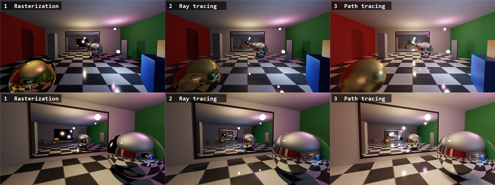

# RtxSlop



An interactive C# / Direct3D 12 demo that renders the same scene in five ways. You can switch between them live:

| Key | Stage | What it shows |
|---|---|---|
| `1` | **Rasterization** | Forward PBR (GGX), omnidirectional cube shadow maps with hardware PCF, planar reflections for the mirrors, a dynamic cube-map reflection probe for the spheres, and 4× MSAA |
| `2` | **Ray tracing** | DXR 1.1 inline ray queries: exact hard shadows, recursive mirror reflections (an infinite corridor between the two facing mirrors), and 4× supersampling |
| `3` | **Path tracing** | GGX with VNDF importance sampling, next event estimation to sphere lights, MIS (power heuristic), Russian roulette, a temporal and à-trous (SVGF-style) denoiser, and primary-surface replacement for mirrors |
| `4` | **Hybrid** | How RTX games do it: primary visibility is rasterized into a G-buffer (position, normal, material), and the path tracer starts from that surface instead of tracing camera rays. Everything after the first hit is traced exactly as in mode 3 |
| `5` | **SDF ray marching** | No triangles, rasterizer or RT cores: the room is ~20 analytic signed distance fields (half-spaces, rotated boxes, spheres), sphere traced in a compute shader. Soft shadows and ambient occlusion come from the distance field itself; mirror/metal reflections are marched too |

The scene is a 12 × 4 × 12 m room with a Cornell-style red and green wall, a polished checkered floor, two mirrors that face each other, pillars and boxes that cast shadows, a chrome sphere and a gold sphere, and three moving colored sphere lights.

## Requirements

- Windows 10/11 and a DXR 1.1 + Shader Model 6.6 GPU (RTX 20xx or newer; built on an RTX 4070)
- .NET 10 SDK

## Build and run

```bash
dotnet run -c Release --project src/RtxSlop
```

The shaders are compiled at startup with DXC, which the NuGet package ships. You can edit `src/RtxSlop/Shaders/*.hlsl` in the output folder and press `F5` to hot-reload them.

## Controls

| Input | Action |
|---|---|
| Left click | Capture the mouse (mouse look) |
| `Esc` | Release the mouse; press again to quit |
| `W A S D` / arrows | Walk |
| `Space`/`E`, `C`/`Q` | Up / down |
| `Shift` | Move fast |
| `1`�`5` / `Tab` | Render mode |
| `L` | Pause or resume the lights (paused + path tracing = converges to a clean reference) |
| `G` | Cycle the model's material: jade (diffuse), glass, gold, mirror |
| `B` / `N` | Fewer / more bounces (all modes except raster) |
| `+` / `-` | Path tracer samples per pixel |
| `F` | Denoiser on / off |
| `M` | Anti-aliasing on / off (MSAA in raster, 4� SSAA in RT and SDF; SDF defaults to off because it costs ~5�) |
| `[` / `]` | Exposure |
| `V` | VSync |
| `F5` | Reload shaders |
| `F12` | Screenshot (saved to `screenshots/` next to the exe) |
| `H` | Hide the HUD |

## Polygon models

A Wavefront `.obj` model sits in the middle of the room. By default it is `data/dragon/dragon.obj` (the Stanford dragon, 871k triangles), found by searching upward from the exe; use `--model <file.obj>` to pick another or `--no-model` to leave it out. The loader (`ObjLoader.cs`) reads positions and faces (polygons, negative indices, `v/vt/vn` forms), fixes winding and handedness, and computes smooth normals. The model is scaled to fit the room and gets its own BLAS/TLAS instance. Each mode renders it its own way:

| Mode | Glass | Gold / mirror |
|---|---|---|
| Raster | Screen-space refraction of the opaque scene + probe reflection | Second dynamic cube-map probe at the model |
| Ray tracing | Whitted reflection + refraction ray tree, Beer absorption, tinted shadow rays | Traced mirror reflection |
| Path tracing / hybrid | Delta dielectric BSDF (caustics emerge naturally) | GGX, glossy |
| SDF | Model baked at startup into a 128³-ish distance texture (GPU jump flooding, sign from ray queries); refraction marches the inside | Marched reflection |

Command-line flags: `--debug` enables the D3D12 debug layer (it needs the Windows "Graphics Tools" optional feature). `--capture <dir>` renders fixed viewpoints in every mode, saves PNGs and timings, then exits.

## Architecture

```
src/RtxSlop/
  Program.cs     window, FPS input, HUD (GDI+ text -> texture), capture script
  Renderer.cs    D3D12 device/swap chain, bindless heap, BLAS/TLAS, all passes
  Scene.cs       procedural geometry (triangles + matching SDF primitives), materials, light animation
  Camera.cs      first-person camera (left-handed, +Y up)
  GpuTypes.cs    constant-buffer layouts, DXR instance desc, upload ring
  Shaders/
    Common.hlsli   root signature, BRDF, RNG, ray-query helpers (shared by all modes)
    Raster.hlsl    VS/PS for the forward pass, the shadow pass and the hybrid G-buffer
    RayTrace.hlsl  Whitted-style compute shader (RayQuery)
    Sdf.hlsl       sphere tracing, SDF soft shadows and AO
    PathTrace.hlsl path tracer compute shader (RayQuery); reads the G-buffer for depth 0 in hybrid mode
    Denoise.hlsl   temporal accumulation and à-trous wavelet filter
    Post.hlsl      ACES tonemap and HUD composite
```

- **Bindless:** Everything uses one root signature: 8 root constants, a frame CBV and a pass CBV. Resources are read through SM 6.6 `ResourceDescriptorHeap[]`, and vertices are fetched from structured buffers, so there are no input layouts or descriptor tables.
- **Shared scene data:** The rasterizer and both ray tracers read the same vertex, index and material buffers and the same BRDF code, which keeps the comparison fair.
- **Acceleration structures:** There is one BLAS for the static room and one unit-sphere BLAS that each light instances. The TLAS is rebuilt every frame as the lights move. Instance masks keep the light bulbs from blocking shadow rays.
- **Denoiser guides:** For pixels that see a mirror, the guides describe the surface *in* the mirror, and its virtual position is reprojected. This keeps reflections stable under camera motion.
