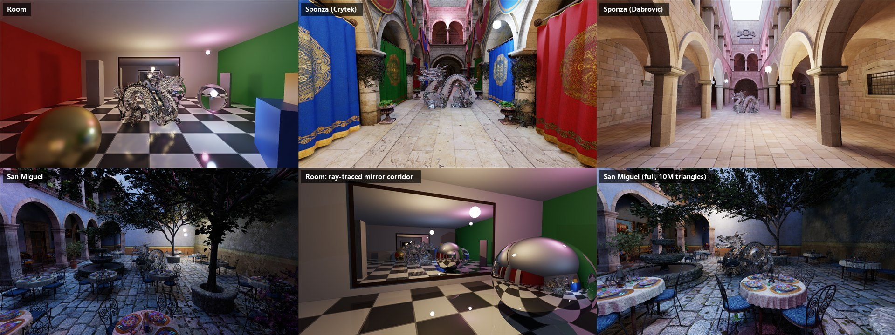
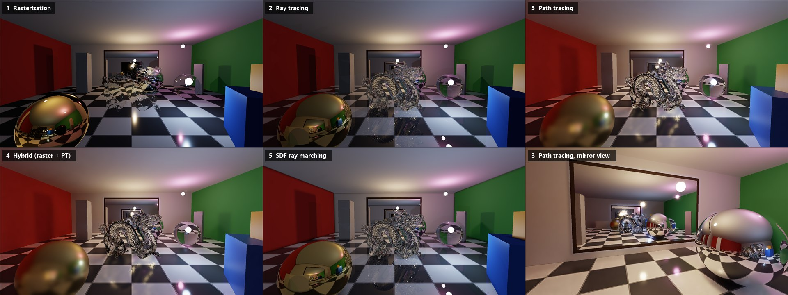
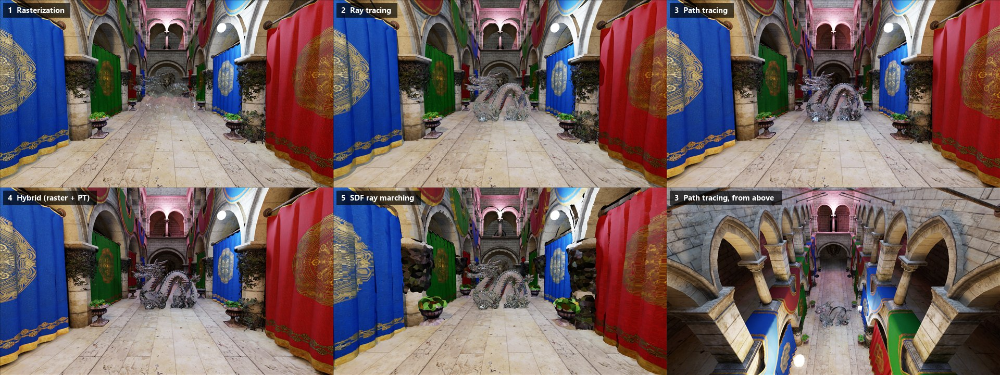
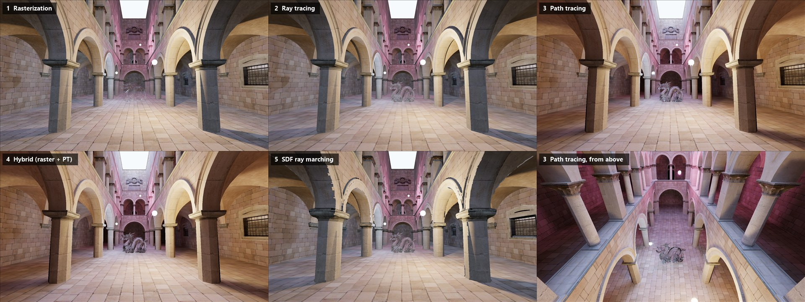
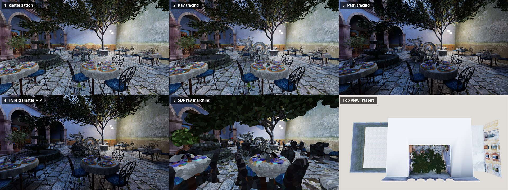
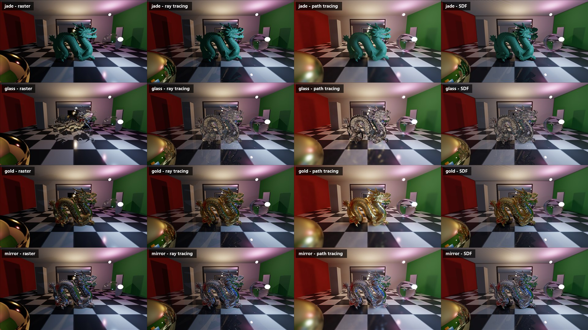
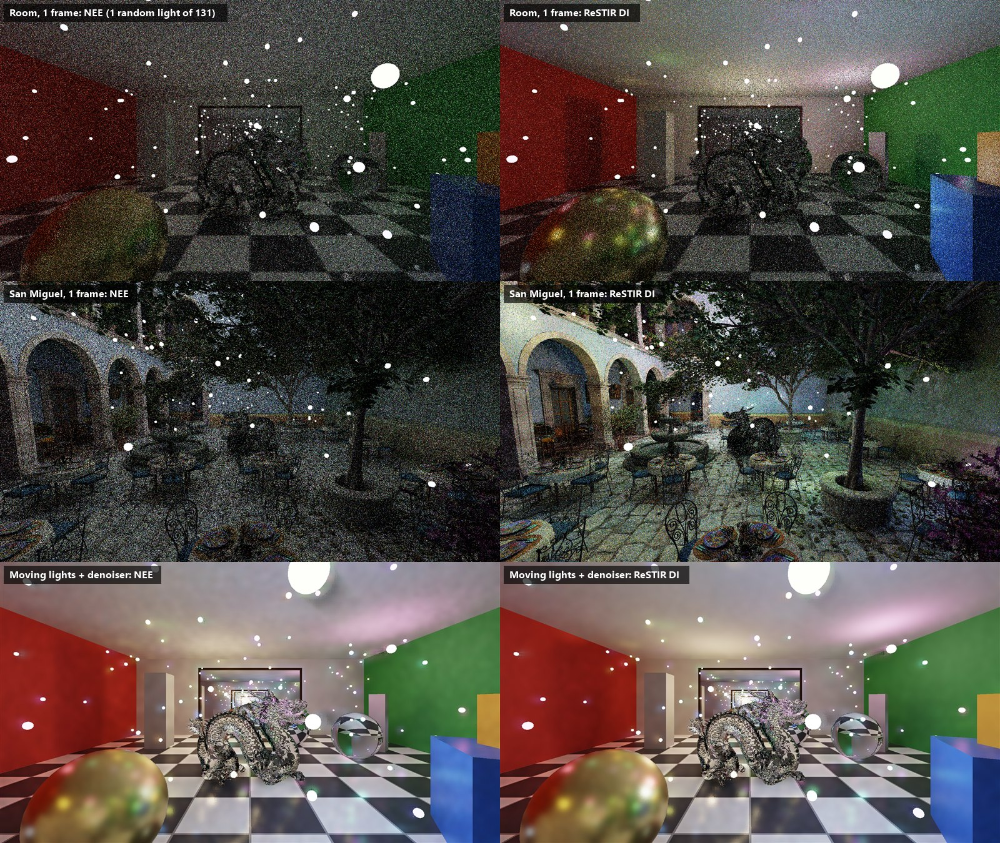
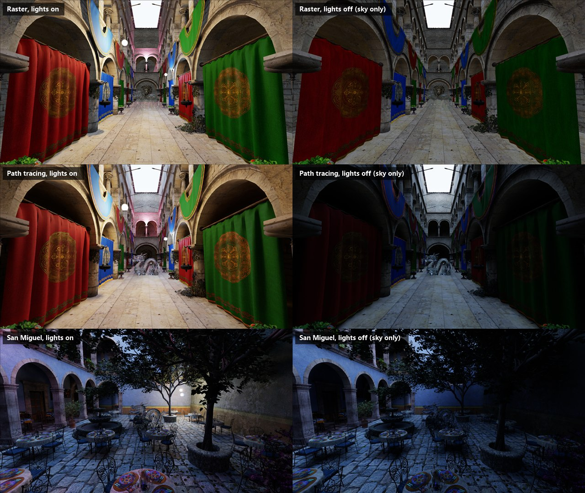

# RtxSlop



An interactive C# / Direct3D 12 demo that renders the same scene in five ways. You can switch between them live:

| Key | Stage | What it shows |
|---|---|---|
| `1` | **Rasterization** | Forward PBR (GGX), omnidirectional cube shadow maps with hardware PCF, planar reflections for the mirrors, a dynamic cube-map reflection probe for the spheres, and 4× MSAA |
| `2` | **Ray tracing** | DXR 1.1 inline ray queries: exact hard shadows, recursive mirror reflections (an infinite corridor between the two facing mirrors), and 4× supersampling |
| `3` | **Path tracing** | GGX with VNDF importance sampling, next event estimation to sphere lights, MIS (power heuristic), Russian roulette, a temporal and à-trous (SVGF-style) denoiser, and primary-surface replacement for mirrors |
| `4` | **Hybrid** | How RTX games do it: primary visibility is rasterized into a G-buffer (position, normal, material), and the path tracer starts from that surface instead of tracing camera rays. Everything after the first hit is traced exactly as in mode 3 |
| `5` | **SDF ray marching** | No rasterizer or RT cores: the room is ~20 analytic signed distance fields (half-spaces, rotated boxes, spheres), and triangle meshes (the dragon, whole buildings) are baked into 3D distance grids, all sphere traced in a compute shader. Soft shadows and ambient occlusion come from the distance field itself; mirror/metal reflections are marched too |

There are five scenes (`F1`–`F5`):

1. **Room**: a 12 × 4 × 12 m procedural room with a Cornell-style red and green wall, a polished checkered floor, two mirrors that face each other, pillars and boxes that cast shadows, a chrome sphere, a gold sphere, a glass ball and the dragon.
2. **Sponza (Crytek)**: a pure triangle mesh (`data/sponza2`, 262k triangles, 25 materials, 54 textures) with the dragon in the middle of the atrium. The roof is open, so it is lit by the sky too.
3. **Sponza (Dabrovic)**: the same setup with Marko Dabrovic's original Sponza (`data/sponza`, 66k triangles, JPG textures). The file has no normals, so the loader generates them with a 45° crease angle: curved stone stays smooth and edges stay sharp.
4. **San Miguel**: the San Miguel 2.1 courtyard (`data/san_miguel`, low-poly version: 5.6M triangles, 220 textures, lots of alpha-tested foliage) with the dragon between the fountain and the trees. The foliage masks live in the base color's alpha channel, and the one translucent material (`d < 1`) becomes glass.
5. **San Miguel (full)**: the same courtyard from the full-detail `san-miguel.obj` (1.1 GB, 10M triangles). It looks nearly identical at normal viewing distances, but it shows how the modes scale: ray and path tracing cost about the same as with 5.6M triangles (BVH traversal is roughly logarithmic), while rasterization, which draws every triangle in every pass, gets about 60% slower.

Every scene has three moving colored sphere lights. `K` switches them off; in the open-air scenes you then see only sky light. `J` adds 128 small drifting lights (131 in total). That is the case ReSTIR DI (`T`) is made for.

## Gallery

All images are straight captures from the app (`--capture`) at 1600×900 on an RTX 4070.

**The five modes, room.** Raster can only fake what the ray tracers compute: a single mirror bounce, a reflection probe for the spheres, screen-space refraction for the glass dragon.



**Crytek Sponza.** Textures, alpha-tested foliage and sky light through the open roof. Path tracing adds the bounce light that fills the arcades.



**Dabrovic Sponza.** Normals are generated at load (45° crease angle).



**San Miguel (5.6M triangles).** The SDF mode shows its limit here: at ~13 cm voxels, chairs and leaves become blobs.



**The model's materials** (`G`): jade, glass, gold and mirror in raster, ray tracing, path tracing and SDF.



**Many lights and ReSTIR DI (`J`, `T`).** With 131 lights, plain next event estimation picks one light at random per bounce, so most of the time it picks a far-away or occluded one. ReSTIR DI (reservoir spatiotemporal importance resampling) resamples 32 light candidates per pixel. It then reuses the winners of the previous frame and of 5 neighbour pixels, so every primary hit shades with one well-chosen, shadow-tested light sample. At about 1.5–2.5 ms per frame, a single frame looks close to a converged image.



**Lights off (`K`).** Only the sky remains. Raster uses baked per-vertex sky visibility plus a small bounce term; the path tracer gets real multi-bounce sky light.



## Requirements

- Windows 10/11 and a DXR 1.1 + Shader Model 6.6 GPU (RTX 20xx or newer; built on an RTX 4070)
- .NET 10 SDK

## Build and run

```bash
dotnet run -c Release --project src/RtxSlop
```

The shaders are compiled at startup with DXC, which the NuGet package ships. You can edit `src/RtxSlop/Shaders/*.hlsl` in the output folder and press `R` to hot-reload them.

## Controls

| Input | Action |
|---|---|
| Left click | Capture the mouse (mouse look) |
| `Esc` | Release the mouse; press again to quit |
| `W A S D` / arrows | Walk |
| `Space`/`E`, `C`/`Q` | Up / down |
| `Shift` | Move fast |
| `1`–`5` / `Tab` | Render mode |
| `L` | Pause or resume the lights (paused + path tracing = converges to a clean reference) |
| `G` | Cycle the model's material: jade (diffuse), glass, gold, mirror |
| `F1`–`F5` | Scene: room / Crytek Sponza / Dabrovic Sponza / San Miguel / San Miguel full (loaded on first use; the very first San Miguel load parses the OBJ for 5–8 s, later loads use the cache) |
| `K` | Lights on / off (off = sky light only) |
| `J` | Many lights: +128 small drifting lights (unshadowed in raster and SDF; only the 3 main lights have shadow maps / soft shadows) |
| `T` | ReSTIR DI on / off for the direct light of path-traced primary hits (modes 3 and 4) |
| `B` / `N` | Fewer / more bounces (all modes except raster) |
| `+` / `-` | Path tracer samples per pixel |
| `F` | Denoiser on / off |
| `M` | Anti-aliasing on / off (MSAA in raster, 4× SSAA in RT and SDF; SDF defaults to off because it costs ~5×) |
| `[` / `]` | Exposure |
| `V` | VSync |
| `R` | Reload shaders |
| `F12` | Screenshot (saved to `screenshots/` next to the exe) |
| `H` | Hide the HUD |

## Polygon models

A Wavefront `.obj` model sits in the middle of the room. By default it is `data/dragon/dragon.obj` (the Stanford dragon, 871k triangles), found by searching upward from the exe; use `--model <file.obj>` to pick another or `--no-model` to leave it out. The loader (`ObjLoader.cs`) reads positions and faces (polygons, negative indices, `v/vt/vn` forms), fixes winding and handedness, and computes smooth normals. The model is scaled to fit the room and gets its own BLAS/TLAS instance. Each mode renders it its own way:

| Mode | Glass | Gold / mirror |
|---|---|---|
| Raster | Screen-space refraction of the opaque scene + probe reflection | Second dynamic cube-map probe at the model |
| Ray tracing | Whitted reflection + refraction ray tree, Beer absorption, tinted shadow rays | Traced mirror reflection |
| Path tracing / hybrid | Delta dielectric BSDF (caustics emerge naturally) | GGX, glossy |
| SDF | Model baked at startup into a 128³-ish distance texture (GPU jump flooding, sign from ray queries); refraction marches the inside | Marched reflection |

## Scenes, textures and sky

- **OBJ cache:** parsed meshes are cached next to the file (`*.obj.rtxcache`) and reused while the `.obj` is unchanged.
- **OBJ + MTL:** faces, UVs, normals and per-face materials are read. Base color (`map_Kd`, sRGB) and alpha masks (`map_d`) are decoded on the CPU in parallel, get a mip chain and are uploaded once. Each scene keeps its own GPU resources (buffers, BLAS/TLAS, textures, SDF grids), so switching back is instant.
- **Alpha testing:** raster uses `clip()`, including in the shadow maps. The ray tracers put foliage in a non-opaque BLAS geometry and alpha-test candidates in the `RayQuery` loop.
- **Texture filtering in the ray tracers:** ray cones pick the mip level from the hit distance, the triangle's texel density and the angle of incidence.
- **Sky:** a horizon-to-zenith gradient. The path tracer gets sky light (and its bounces) for free. For the other modes, the sky visibility of every vertex is baked once on the GPU with ray queries (64 rays per vertex) and used as ambient occlusion, plus a small constant for light bounced around the building.
- **SDF mode in Sponza:** the whole building is baked into one *unsigned* distance grid of about 10 cm voxels, since open architecture has no inside. The bake also stores the nearest triangle per voxel, so SDF hits are shaded with the exact triangle's UV, normal, material and sky visibility. Visibility is still voxel-coarse, which shows on foliage.

Command-line flags: `--sponza` starts in Sponza. `--debug` enables the D3D12 debug layer (it needs the Windows "Graphics Tools" optional feature). `--capture <dir>` renders fixed viewpoints in every mode, saves PNGs and timings, then exits. `--bench <dir>` only measures GPU time per scene, mode and model material (`bench.txt`). `--capture <dir> --scenes 1,3` limits the capture to some scenes (0 = room ... 4 = San Miguel full). `--capture <dir> --restir` only captures the many-lights comparison (NEE vs ReSTIR DI: single frame, moving lights, converged) and its timings.

## Architecture

```
src/RtxSlop/
  Program.cs     window, FPS input, HUD (GDI+ text -> texture), capture script
  Renderer.cs    D3D12 device/swap chain, pipelines, all passes of the five modes
  RendererScene.cs  per-scene GPU data: buffers, textures, BLAS/TLAS, SDF + sky-visibility bakes
  Scene.cs       the two scenes: room (procedural) and Sponza (OBJ/MTL), materials, light animation
  ObjLoader.cs   OBJ/MTL reader
  Camera.cs      first-person camera (left-handed, +Y up)
  GpuTypes.cs    constant-buffer layouts, DXR instance desc, upload ring
  Shaders/
    Common.hlsli   root signature, BRDF, RNG, ray-query helpers (shared by all modes)
    Raster.hlsl    VS/PS for the forward pass, the shadow pass and the hybrid G-buffer
    RayTrace.hlsl  Whitted-style compute shader (RayQuery)
    Sdf.hlsl       sphere tracing, SDF soft shadows and AO
    PathTrace.hlsl path tracer compute shader (RayQuery); reads the G-buffer for depth 0 in hybrid mode
    Restir.hlsl    ReSTIR DI: initial candidates + temporal reuse, spatial reuse (before the path tracer)
    Denoise.hlsl   temporal accumulation and à-trous wavelet filter
    Post.hlsl      ACES tonemap and HUD composite
```

- **Bindless:** Everything uses one root signature: 8 root constants, a frame CBV and a pass CBV. Resources are read through SM 6.6 `ResourceDescriptorHeap[]`, and vertices are fetched from structured buffers, so there are no input layouts or descriptor tables.
- **Shared scene data:** The rasterizer and both ray tracers read the same vertex, index and material buffers and the same BRDF code, which keeps the comparison fair.
- **Acceleration structures:** There is one BLAS for the static room and one unit-sphere BLAS that each light instances. The TLAS is rebuilt every frame as the lights move. Instance masks keep the light bulbs from blocking shadow rays.
- **ReSTIR DI:** A light sample is stored as (light index, direction from the light's center to the point on its sphere), so it stays attached to a light that moves. Candidates are drawn in area measure, which lets any pixel reuse them without a Jacobian. Temporal and spatial reuse use the generalized balance heuristic, with each pixel's own target function and a confidence M (history capped at 20× the 32 candidates). Cheaper 1/M weights made surfaces near a light about 5% too bright. The only remaining bias is from visibility, and the winner is shadow-tested again after the spatial pass.
- **Denoiser guides:** For pixels that see a mirror, the guides describe the surface *in* the mirror, and its virtual position is reprojected. This keeps reflections stable under camera motion.
